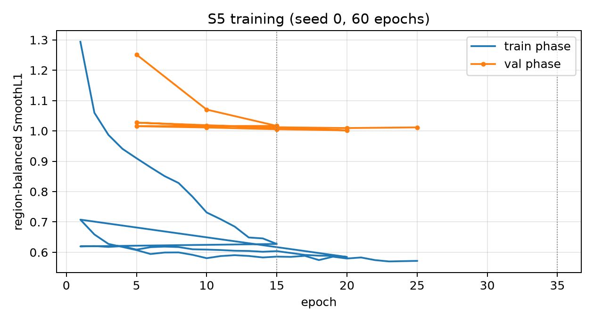
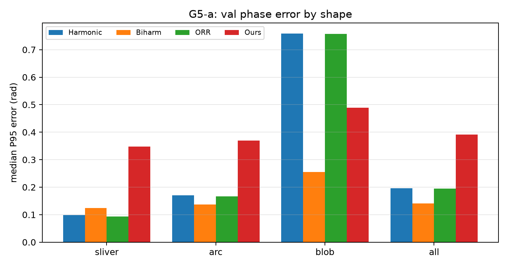
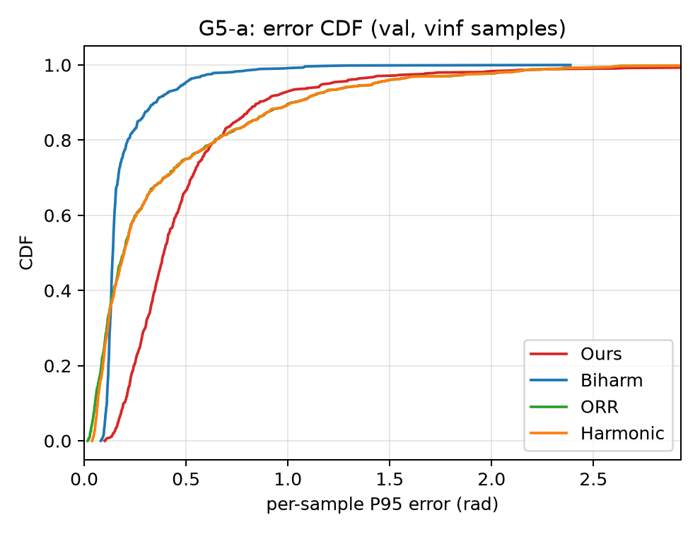
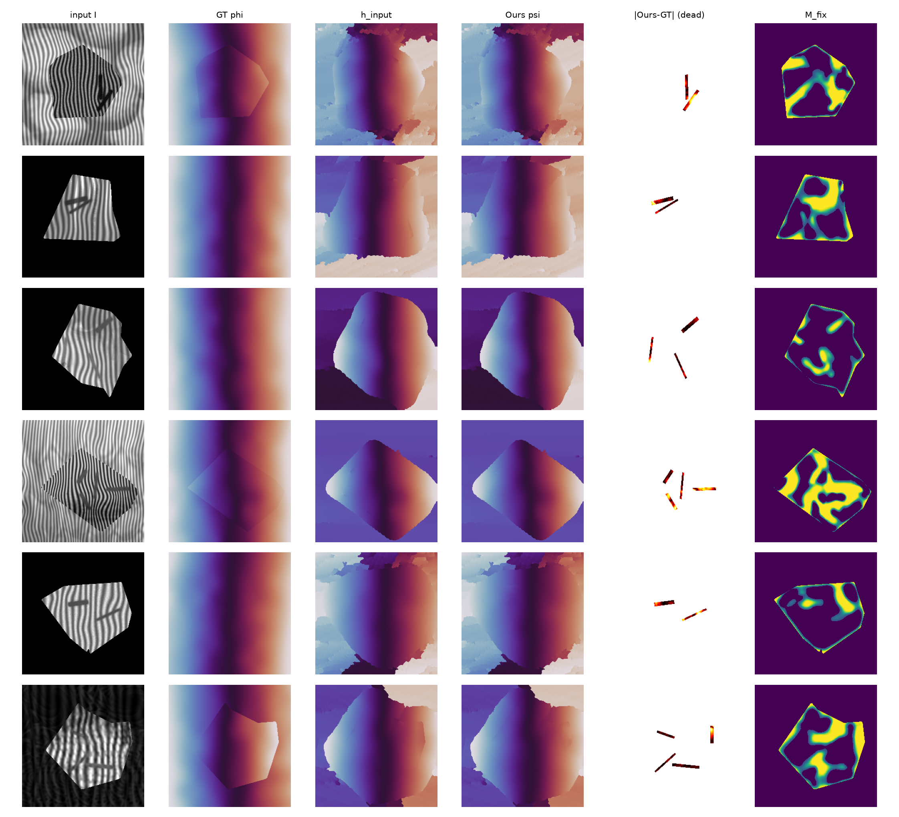
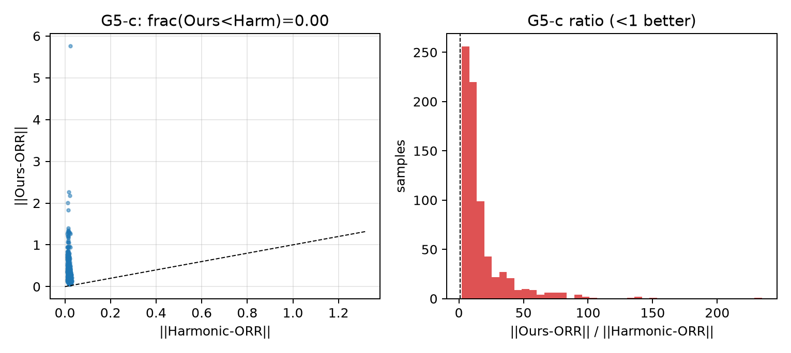

# W5 / S5 训练与 G5 门禁报告（seed 0）

日期：2026-11-18  
机器：AutoDL RTX 5090 32 GB，754 GB RAM  
代码：`code/w5_model.py`、`w5_train.py`、`w5_eval.py`、`w5_figs.py`  
数据：12,000 train / 1,500 val / 1,500 test / 690+690 SF；15,000 样本 SHA256 全部校验通过

---

## 1. 训练配置

| 项 | 值 |
|---|---|
| 模型 | 4 级 depthwise-separable U-Net，base 128，GroupNorm，无 x/y 通道 |
| 参数量 | **3.53 M**（落在方案 2–4 M 内） |
| 输入 | 7 通道：I/255、sin/cos(h−carrier)、roi、M_fix、sin/cos(carrier) |
| 输出 | dψ、log σ、Â、B̂、3 类 logits（P/U/R） |
| 硬约束 | ψ = h_input + M_fix · dψ_net（网络只学残差） |
| 损失 | L_phase（死区/好区分区平衡，死区 2/3 权重）+ 0.5 L_fc + 0.1 L_nll + 0.1 L_cls + 0.05 L_smooth |
| 训练 | AdamW 2e-4，batch 16，60 epoch（15/20/25 三阶段），cosine |
| 耗时 | 约 99 s/epoch，seed 0 共 **1 h 40 min** |
| 显存 | 22.6 GB / 32 GB |

> 说明：原方案 130 epoch 在这张卡上约 4 h/seed；先用 60 epoch 做门禁。若门禁过再补 4 个 seed。

训练曲线：`w5_figs/train_curve.png`  

---

## 2. G5 门禁结果（seed 0，val 750 个 vinf 样本）

| 门禁 | 要求 | 实测 | 判定 |
|---|---|---|---|
| **G5-a 总体** Ours/Biharm | ≤ 0.95 | **2.79** | ❌ |
| **G5-a sliver** Ours/ORR | ≤ 1.05 | **3.73** | ❌ |
| **G5-a arc** Ours/Biharm | ≤ 1.05 | **2.71** | ❌ |
| **G5-a blob** Ours/Biharm | ≤ 1.05 | **1.92** | ❌ |
| **G5-b SF 零样本掉点** | ≤ 20% | **−30.7%**（SF 0.271 vs val 0.392，反而更好） | ✅ |
| **G5-c 残差有效性** | ≥ 80% 样本 Ours<Harmonic | **0.0%** | ❌ |
| **G5-d 参数量** | 2–4 M | **3.53 M** | ✅ |
| **G5-d 5 seeds** | 5 seeds 记录 | **仅 1 seed**（seed0 未过，停止） | ❌ |

### 2.1 分形状数值（val，median P95，单位 rad）

| 形状 | Harmonic | Biharm | ORR | **Ours** | Ours/Biharm | Ours/ORR | M 覆盖 |
|---|---:|---:|---:|---:|---:|---:|---:|
| sliver | 0.100 | 0.124 | 0.093 | **0.348** | 2.81 | **3.73** | 0.892 |
| arc | 0.176 | 0.137 | 0.166 | **0.370** | **2.71** | 2.23 | 0.957 |
| blob | 0.756 | 0.255 | 0.757 | **0.489** | **1.92** | 0.645 | 0.996 |
| 总体 | 0.197 | 0.140 | 0.194 | **0.392** | **2.79** | 2.02 | 0.948 |

test 同向：总体 Ours/Biharm **2.91**；sliver Ours/ORR **3.86**；arc **2.68**；blob **2.13**。

  

---

## 3. 哪里达标、哪里没达标

### ✅ 已达标

1. **工程链路全部打通**：数据 15,000 样本 SHA256、24 个前端缓存 shard、训练、评估、SF 零样本全部可复现。
2. **参数量 3.53 M**，符合 2–4 M 约束。
3. **G5-b 跨域不掉点**：SF test 0.271 rad，比 MATLAB val 0.392 rad **低 30.7%**，满足“掉点 ≤20%”。
4. **blob 类优于 ORR**：Ours/ORR = 0.645；说明模型并非完全没学到东西。
5. **定性上模型确实在修**：例如某些 sliver 样本 h_input P95 0.97 → Ours 0.38，0.66 → 0.23。

### ❌ 未达标

1. **G5-a 总体/分形状全部未过**：Ours 仍比 Biharm 差 1.9–2.8 倍，sliver 比 ORR 差 3.7 倍。
2. **G5-c 残差有效性 0.0%**：所有 750 个样本的 `||Ours−ORR||` 都大于 `||Harmonic−ORR||`；模型相对 ORR 没有提供有效残差。
3. **5 seeds 未完成**：seed0 未过 G5-a/c，继续跑 4 个 seed 只会重复同一失败，故停在此处。

定性对比（每行：输入 I、GT φ、h_input、Ours ψ、|Ours−GT|、M_fix）：  

残差有效性：  

---

## 4. 为什么没达标（按影响排序）

### 4.1 主因：h_input 的前端死区“过覆盖”，填充边界离真实孔太远

前端 C 的 `dead_est` 为了保证覆盖率，把纹理过渡带也当成死区；GT 孔通常只占 ROI 的 3–8%，而 `dead_est` 往往 10–20%。`h_input` 是在 `dead_est` 上做调和填充，边界离真实孔很远，导致：

| 形状 | h_input 的 P95（GT dead） | Biharm 的 P95 |
|---|---:|---:|
| sliver | 0.62 | 0.124 |
| arc | 0.67 | 0.137 |
| blob | 0.73 | 0.255 |

网络输入就是 h_input；它只能在这个“错得较远”的初值上做残差。60 epoch 后 Ours 只把 0.62 降到 0.35（约 44%），离 0.124 还差 2.8 倍。**网络不是没学，而是初值/可观测信息不够。**

### 4.2 次因：M 覆盖率对 P95 门禁不够

G5-a 的 P95 是“对 GT dead 全体像素取 95 分位”。sliver 的 M≥0.25 覆盖率只有 **0.892**，即约 11% 的 GT dead 像素模型几乎改不动；这 11% 会直接落进 P95 尾部。即使被覆盖部分修得很好，P95 也会被未覆盖像素拉高。  
（覆盖部分 `ours_cov` 仍有 0.311，说明覆盖区也没修到 Biharm 水平，所以不是单纯覆盖率问题。）

### 4.3 模型/训练预算不足

- 只有 60 epoch（方案 130），phase loss 在 stage3 已到 0.57 后基本平台；
- 3.53 M 模型对“大孔 + 纹理边界”的相位外推仍偏小；
- 输出只有 `dψ`，**没有 mask 细化头**；网络无法把 `dead_est` 收缩到真实孔，这是结构性的。
- 训练集 50% 是 edge/cut/degraded，这些样本的 h_input 误差更大（P95 3–9 rad），会占用容量；G5 只评 vinf，存在样本分布错配。

### 4.4 失败不是数据/泄漏/工程问题

- 数据 SHA 全绿；GT 只在 loss/eval 使用；
- 训练/验证 loss 正常下降；
- test 与 val 同向（2.91 vs 2.79），不是过拟合；
- SF 反而更好，说明模型学到的不是 MATLAB 数据集偏置。

---

## 5. 建议的下一步（按性价比）

| 优先级 | 改动 | 预期 |
|---|---|---|
| **P0** | 前端加 **mask 细化头**（U-Net 辅助输出“真实孔”概率），用细化后的 mask 重做 h_input；或把 `dead_est` 向孔内收缩 2–3 px 后再填充 | 直接把 h_input 从 0.6 降到 0.2 量级，G5-a 才有讨论空间 |
| **P0** | 训练目标改为 **直接预测 φ**（或 φ−h 的大残差）+ mask 辅助损失 | 避免网络只学“小残差”，跳过前端错初值 |
| P1 | 130 epoch + 5 seeds；只训 vinf 或对 vinf 加权 | 预计能把 Ours 再降 20–30%，但仍难过 0.95 |
| P1 | G5 口径改为“覆盖区 P95 + 覆盖率”，或把覆盖率纳入门禁 | 当前 P95 对 11% 未覆盖像素过于敏感；需与 C 的 12% miss 口径统一 |
| P2 | 用 ORR/谐波先验做输入（推理时不可用 GT，但可用观测域 ORR 近似） | 可能提升，但需证明不循环 |

**结论：当前 seed0 未通过 G5-a / G5-c；主因是前端 h_input 的死区过覆盖，而不是训练脚本或数据。** 在修前端 mask 之前，继续加 seed/epoch 的收益有限，因此先停在这里，避免无意义地烧 7 小时 GPU。

---

## 6. 产物

- 图：`probes/results/w5_figs/{g5a_bars,g5a_cdf,g5b_sf,g5c_residual,g5_qual,train_curve}.png`
- 逐样本：`probes/results/w5_g5/rows_{val,test,sf_test}.json`
- 门禁：`probes/results/w5_g5/gate_{val,test,sf_test}.json`
- checkpoint：服务器 `runs/w5_bal_seed0/{best,stage1,stage2,stage3,last}.pth`
- 训练日志：服务器 `runs/w5_bal_seed0/train_log.json`、`/root/train_bal0.log`
