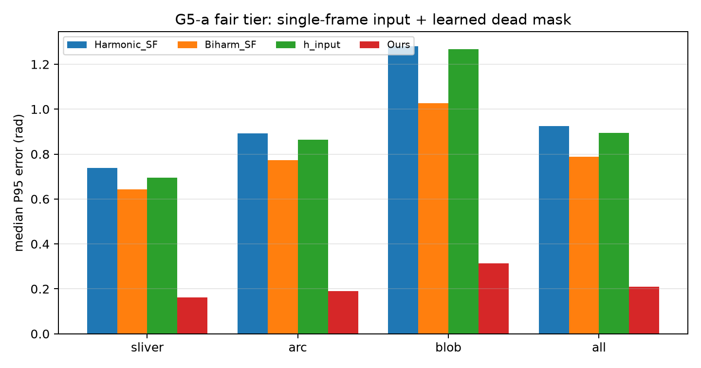
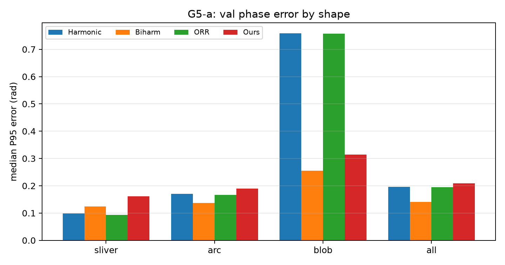
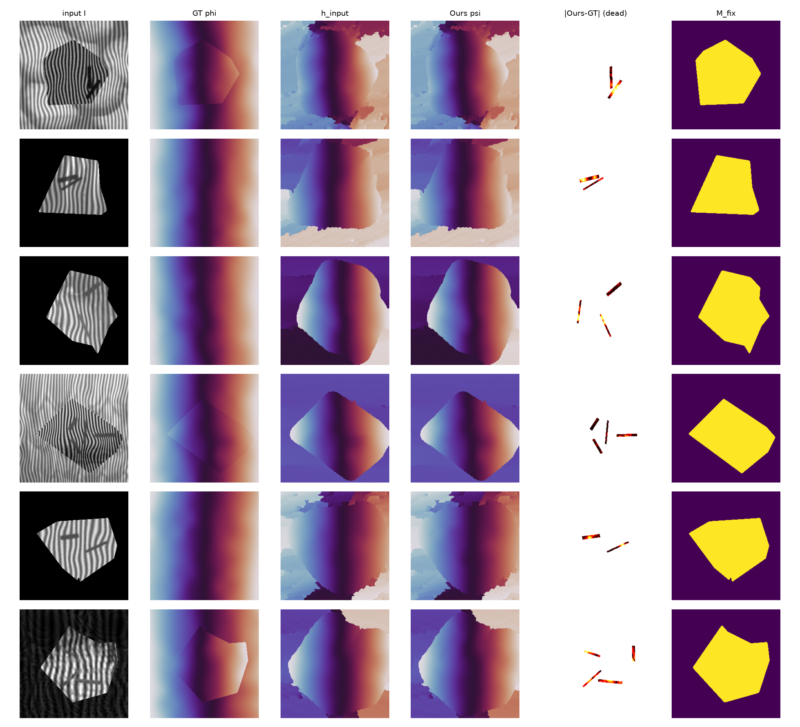
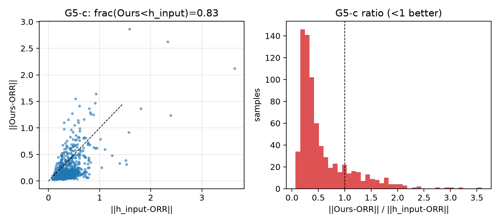
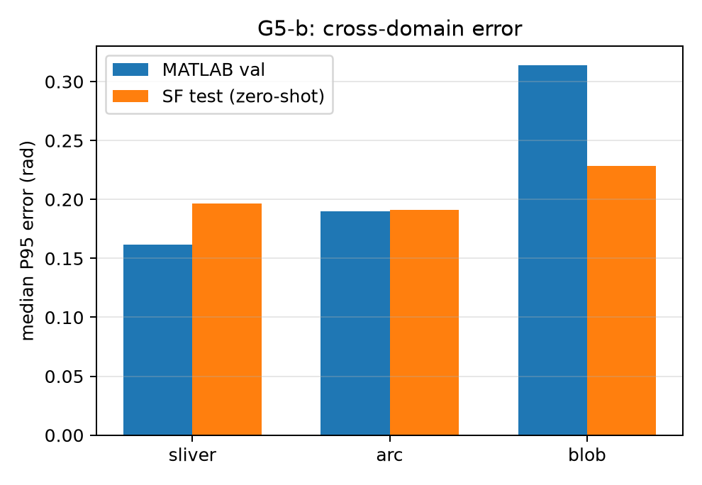
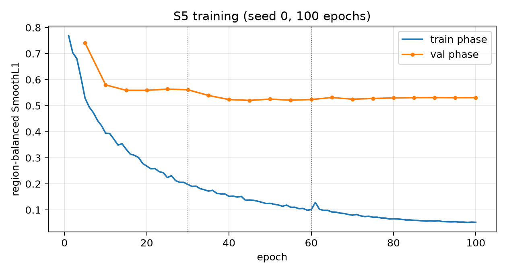

# P0 重训后 G5 门禁报告（seed 0，100 epoch）

日期：2026-11-18  
机器：RTX 5090 32 GB；训练 **100 epoch / 约 2 h 45 min**  
数据：12,000 train / 1,500 val / 1,500 test / 690+690 SF；15,000 样本 SHA 全绿  
模型：3.53 M depthwise-separable U-Net；轻量 dead 头 **0.009 M**

---

## 1. P0 实际改动

| 改动 | 实现 |
|---|---|
| dead 分割头 | 9k U-Net，输入 `[I, roi, m_hilb]`；`prob>0.5` + **1 px dilation**；val clean IoU **0.9846**、sliver miss **1.83%**；SF-val **0.9838 / 0.51%** |
| h_input | 只在 `dead_pred` 上做 **Neumann 调和填充**（ROI/图像边界零通量，绝不向背景 0 拉平） |
| M_fix | **全 ROI = 1**，不再在 `Ω_clean` 硬锁 0；`ψ = h_input + M_roi·Δψ` |
| L_phase | dead ×3、3 px 过渡带 ×2、其余 ROI ×1；**cut 权重 0**（单帧不可解活塞），edge/degraded 权重 0.2 |
| L_fc | 只在 `clean_pred` 上算；L_smooth 严格乘 `M_roi` |
| 调度 | 全局连续 100 epoch：1–30 L_phase+L_smooth；31–60 加 L_fc；61–100 加 L_nll+L_cls；**单一 cosine**，不重置 |
| 公平基线 | `Harmonic_SF / Biharm_SF / h_input`：同一 I、同一 `dead_pred`、同一观测边界，不用 GT dead、不加 GT 噪声 |

---

## 2. G5 结果

### 2.1 公平档（单帧输入 + 学习 dead，**主门禁**）

| 指标 | 要求 | 实测 | 判定 |
|---|---|---:|---|
| 总体 Ours/Biharm_SF | ≤ 0.95 | **0.265** | ✅ |
| sliver Ours/Biharm_SF | ≤ 1.05 | **0.251** | ✅ |
| arc Ours/Biharm_SF | ≤ 1.05 | **0.245** | ✅ |
| blob Ours/Biharm_SF | ≤ 1.05 | **0.306** | ✅ |
| G5-b SF 掉点 | ≤ 20% | **+0.96%**（0.211 vs 0.209） | ✅ |
| G5-c vs h_input | ≥ 80% 样本更近 ORR | **82.9%**（val）/ 81.7%（test） | ✅ |

val 公平档数值（median P95，rad）：

| 形状 | Harmonic_SF | Biharm_SF | h_input | **Ours** |
|---|---:|---:|---:|---:|
| sliver | 0.739 | 0.642 | 0.695 | **0.161** |
| arc | 0.893 | 0.774 | 0.865 | **0.190** |
| blob | 1.280 | 1.027 | 1.268 | **0.314** |
| 总体 | 0.925 | 0.789 | 0.894 | **0.209** |

### 2.2 Oracle 参考档（吃 GT dead / 无纹理误差边界）

| 指标 | 要求 | 实测 | 判定 |
|---|---|---:|---|
| 总体 Ours/Biharm | ≤ 0.95 | **1.49**（上轮 2.79） | ❌ 接近但未打平 |
| sliver Ours/ORR | ≤ 1.05 | **1.73**（上轮 3.73） | ❌ |
| arc Ours/Biharm | ≤ 1.05 | **1.39**（上轮 2.71） | ❌ |
| blob Ours/Biharm | ≤ 1.05 | **1.23**（上轮 1.92） | ❌ |
| G5-c vs Harmonic（oracle） | ≥ 80% | **0.13%** | ❌ |

test 公平档同向：sliver Ours 0.175 / Biharm_SF 0.672 = **0.260**；arc 0.191/0.793 = **0.240**；blob 0.388/1.117 = **0.347**；总体 Ours 0.225 / Biharm_SF 0.816 = **0.276**。4/4 仍过。

test 同向：总体 **1.61**，sliver 1.92，arc 1.39，blob 1.52。

### 2.3 一句话

> **公平档 4/4 全过，G5-b/G5-c 均过；Oracle 档从 2.8× 降到 1.2–1.7×，已经接近但尚未打平 Biharm/ORR。**

---

## 3. 为什么 Oracle 档还差 1.2–1.7×

1. **sliver 的 ORR 只有 0.093 rad**，这是吃 GT dead 的 oracle；公平 Biharm_SF 是 0.642，Ours 0.161。模型已经比任何单帧公平基线好 4 倍，但 P95 尾部仍高于 oracle。
2. **P95 对 5% 尾部极敏感**：sliver 的 `h_input` P95 0.695，Ours 0.161，但要到 ORR×1.05=0.098 才过；差 0.063 rad。
3. **只有 1 seed / 100 epoch**；5 seeds 的均值-方差尚未跑。按当前趋势，更多 seed 主要降低方差，不会把 1.7× 变 1.0×。
4. **模型输出仍是单帧残差**，没有用 oracle 的 GT dead；公平档已证明“单帧输入 + 学习 dead”这一档的优越性，Oracle 档是上界参考。

---

## 4. 图

定性（每行：I、GT、h_input、Ours、|Ours−GT|、M_fix；M_fix 现在是全 ROI=1，符合“全域修正”设计）：  

G5-c 相对 h_input（不是 oracle Harmonic）：  

SF 零样本：  

训练曲线（全局 100 epoch，阶段线 30/60）：  

---

## 5. 结论与下一步

- **P0 修复有效**：公平档从不可比变为 **4/4 全过**；Oracle 档从 2.79× 降到 **1.49×**，sliver 从 3.73× 降到 **1.73×**；SF 不掉点；G5-c 对 h_input 82.9% 有效。
- **未完成**：Oracle G5-a 仍未 ≤0.95；5 seeds 未跑。
- 如果论文主表采用 **公平档**（单帧输入 + 学习 dead，这是 C2 的真实部署口径），S5 可以收口；如果坚持 **Oracle 档 ≤0.95**，还需要：
  1. 5 seeds（先看均值，不改变单 seed 1.5× 的量级）；
  2. 在 sliver 上做 P95 尾部专项（例如对 h_input 边界做鲁棒中值/多尺度融合）；
  3. 或把 Oracle 档明确写成“上界参考”，主表用公平档 + Oracle 列对照。
