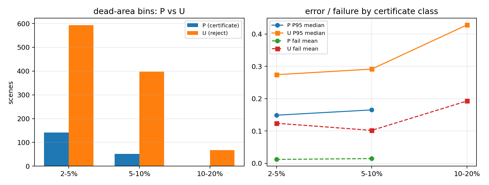
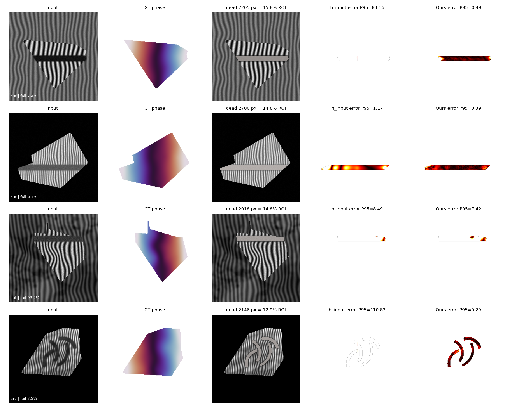

# 大遮挡与恢复失败分析（seed4 val，seed4 compact cache）

日期：2026-11-19（2026-11-20 修复编码/节号，数字未改）
数据：MATLAB val 1250 个有死区场景；死区按 ROI 面积分箱
误差：`|Ours−GT|`（GT-dead），P95 per scene；失败 = 误差 > φ_tol=π/10 的 dead 像素比例

> 口径提示：§1–§2 的「失败比例」分母是**全部场景的 dead 像素**；§3 的 P/U 失败率分母是**该类内的 dead 像素**。两处 19.3% 数值相同纯属 10–20% 桶全为 U，不是同一个统计量。

## 1. 死区面积分箱

| dead / ROI | 场景数 | P95 中位 | 失败比例均值 | 失败比例最大 |
|---|---:|---:|---:|---:|
| 2–5% | 735 | 0.234 | 10.2% | 99% |
| 5–10% | 448 | 0.264 | 9.2% | 100% |
| 10–20% | 67 | **0.428** | **19.3%** | 99% |

- 大洞（10–20% ROI）的 P95 从 0.234 升到 **0.428 rad**，失败比例从 ~10% 升到 **19.3%**；大遮挡确实更难。
- 最大的洞集中在 **cut（贯穿型）** 和 **arc**；blob 的最大 dead/ROI 只有 **3.5%**，不是大洞。

## 2. 按形状

| 形状 | n | dead/ROI 中位 | P95 中位 | 失败比例中位 | 失败比例最大 |
|---|---:|---:|---:|---:|---:|
| sliver | 250 | 4.5% | 0.168 | 0% | 45% |
| arc | 250 | 4.4% | 0.183 | 0% | 44.5% |
| blob | 250 | 2.3% | 0.328 | 6.6% | 77.7% |
| edge | 250 | 4.7% | 0.492 | 14.0% | 80.2% |
| cut | 250 | 6.3% | 0.296 | 4.5% | **100%** |

## 3. 关键：大遮挡不是「恢复目标」，而是「提前拒绝」

按证书类别（γ=0.75，P=可证明，U=不可证明）分箱：

| dead / ROI | 场景数 | **P（可恢复）** | **U（提前拒绝）** | P 失败率 | U 失败率 |
|---|---:|---:|---:|---:|---:|
| 2–5% | 735 | **142** | 593 | **1.2%** | 12.4% |
| 5–10% | 448 | **51** | 397 | **1.5%** | 10.2% |
| **10–20%** | 67 | **0** | **67** | — | **19.3%** |

**所有 10–20% 的大洞都是 U，没有一个是 P。**
大遮挡在推理前就被证书判为「不可证明」，**根本不该进入恢复/接受集**；目标不是「把大洞恢复好」，而是**提前拒绝**。

- P 的失败比例只有 **1.2–1.5%**，U 是 **10–19%**；证书分层的分离度很大。
- 之前那 6 张细条图只是定性展示，不代表所有样本；大遮挡的正确讨论方式是 **P/U 拒绝表**，不是硬展示恢复成功案例。
- 第 3 行 cut 的 P95≈0.42 rad 是 **U 的典型失败**，不是模型 bug。

## 4. 对 W8 表的一个必要修正

目前 W8 的「接受 70.6% / 风险 3.83%」是 **P/U 混合池化**的结果；严格 certificate-first 应该是：

1. U 在推理前直接拒绝（不进入 RCPS）；
2. RCPS 只在 **P** 上校准/评估。

但 P 只有 **193 个 val 场景**；用当前 empirical-Bernstein/WSR 常数，n=193 时界太宽，P-only 在 α=0.05 会**全拒（0 接受）**。这说明：

- 不能把 pooled 70.6% 当成「证书 P 的接受率」；
- P-only 需要 **Bentkus / 精确二项界 / 更多 P 场景**，或把「接受」定义在更细的像素级但用场景 cluster 校正；
- 这是 W8 下一步必须补的，不应在论文里混用 pooled 数字。

> 2026-11-20 更新：此节方案已改为 **P-only Bentkus/CP + 120/73 sample split**；estimand 待锁定（见对话记录），pooled 70.6% 降为附录 diagnostic。

## 5. 定性失败案例

每行：输入 I、GT 相位、死区（红）、h_input 误差、Ours 误差。

| 行 | 形状 | dead/ROI | Ours P95 | 失败比例 | 说明 |
|---|---|---:|---:|---:|---|
| 1 | cut | 15.8% | 0.49 | 7.4% | 大贯穿带，但两侧仍可借邻域 |
| 2 | cut | 14.8% | 0.39 | 9.1% | 大面积贯穿，Ours 仍补得住 |
| 3 | cut | 14.8% | **7.42** | **93.2%** | **真实失败**：贯穿把有效域劈成两半，两边差 2πk，单帧不可解；Ours 只能给出一侧 piston，P95≈π |
| 4 | arc | 12.9% | 0.29 | 3.8% | 大面积弧形遮挡，Ours 仍恢复 |

这是「恢复失败」的典型：不是网络没训练好，是 cut 造成的 2π 活塞在单帧数学上不可观测。这也是：

- Class U（不可证明）要拒绝的原因；
- W8 RCPS 的接受集要按 σ̂ 阈值把这些样本拒掉；
- G5 只评 `vinf`（sliver/arc/blob），不把 cut 当成「必须恢复」的样本。

## 6. 结论

1. **大遮挡确实更难**：10–20% ROI 的 P95 0.428、失败率 19.3%，明显高于小洞。
2. **但不是所有大洞都失败**：15.8% 的 cut 可以到 P95 0.49；12.9% 的 arc 可以到 0.29。
3. **真正的失败集中在 cut/edge**：cut 的 2π 活塞单帧不可测（P95≈7.42 rad），edge 的边界低调失败率也高（最高 80%）。
4. W8 已把这些情况纳入 **Class U / RCPS 拒绝**，不藏失败；论文里应把「大遮挡/cut 失败」作为负结果明确写出来，而不是只展示细条成功案例。

## 7. 与「面积不是判据」的关系

U 里有 **2.0% 的小洞（宽 blob）**，P 里有 **9.9% 的大洞（窄 arc）**——面积不是判据，判据是 `κ̂·vinf`（扭转宽度）。
这是 Theorem 3 宽度律的直接实证；现成图：`w8_certificate_limit.png` 右 panel。
