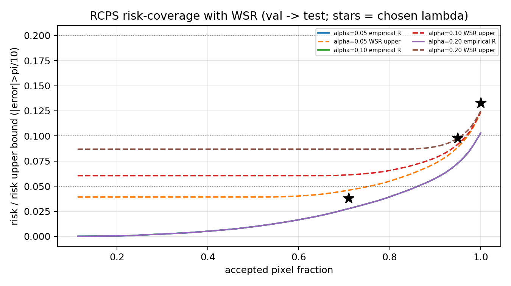

# W8 初版汇总：两级 Conformal + RCPS（seed 4）

日期：2026-11-19（2026-11-20 补 C3 P-only 官方重算）  
模型：S5 5 seeds，`runs/w5_p0_seed{0..4}/best_stage3.pth`  
校准：MATLAB val（P 193 / 混合 1250）  
评估：MATLAB test（P 189 / 混合 1250）  
代码：`code/w8_conformal.py`、`w8_rcps.py`、`w8_selfcheck.py`

---

## 0. C3 主表改为 P-only（官方 float32 5 seeds）

C1 证书判 U 的样本在推理前拒绝，**C3 只对 P 承诺覆盖**；τ 校准/评估都只取 P（val 193 / test 189）。  
来源：`probes/results/w8_p_only/seed{0..4}.json`（官方 `w8_conformal.py`，float32，非 float16 缓存）。

| α | 目标 | P-only 5-seed mean ± std | 逐 seed | 旧 all-class（附录） |
|---:|---:|---:|---|---:|
| 0.05 | 0.95 | **0.9344 ± 0.0178** | 0.931 / 0.963 / 0.926 / 0.915 / 0.937 | 0.9318 ± 0.0121 |
| 0.10 | 0.90 | **0.8857 ± 0.0330** | 0.884 / 0.937 / 0.852 / 0.862 / 0.894 | 0.8760 ± 0.0105 |
| 0.20 | 0.80 | **0.7841 ± 0.0405** | 0.799 / 0.841 / 0.730 / 0.778 / 0.772 | 0.7691 ± 0.0038 |

- P-only 的 **std 明显更大**（α=.10/.20 为 0.033/0.041），因为 n=193/189、外层分位数更粗；论文必须报 std。
- **OOD 仍未达**：差 1.6 / 1.4 / 1.6 pt；G6 OOD 不达标。
- U 不承诺覆盖；旧 all-class 数只作诊断。
- compact preview（float16）为 .9323/.8825/.7852，与官方差 1–2 scene；**主表用官方 float32**。
- P-only selfcheck 尚未官方重算（待补）；旧自检 0.952/0.901/0.803 是 mixed。

---

## 1. 两级 Conformal（β = 未覆盖率，β=0.05 对应 95% 场景内覆盖）

> 下表是 **all-class（P/U 混合）诊断**，不是 C3 主表；主表见 §0。

| α | β | 目标覆盖 | 全局 success | P 类 | U 类 | 像素级基线 | G6（目标 ≥1−α） |
|---:|---:|---:|---:|---:|---:|---:|---|
| 0.05 | 0.05 | 95% | **0.941** | 0.937 | 0.950 | 0.712 | ❌ 差 0.9% |
| 0.05 | 0.10 | 90% | 0.942 | 0.942 | 0.945 | 0.814 | ✅ |
| 0.05 | 0.20 | 80% | 0.941 | 0.937 | 0.945 | 0.908 | ✅ |
| 0.10 | 0.05 | 95% | 0.877 | 0.894 | 0.883 | 0.488 | ❌ 差 2.3% |
| 0.10 | 0.10 | 90% | 0.883 | 0.862 | 0.884 | 0.645 | ❌ 差 1.7% |
| 0.10 | 0.20 | 80% | 0.871 | 0.862 | 0.893 | 0.794 | ❌ 差 2.9% |
| 0.20 | 0.05 | 95% | 0.773 | 0.772 | 0.773 | 0.181 | ❌ 差 2.7% |
| 0.20 | 0.10 | 90% | 0.754 | 0.767 | 0.747 | 0.322 | ❌ 差 4.6% |
| 0.20 | 0.20 | 80% | 0.758 | 0.772 | 0.754 | 0.554 | ❌ 差 4.2% |

**结论：** 场景级 conformal 显著优于像素级基线（α=0.05：0.941 vs 0.712；α=0.10：0.877 vs 0.488），但 val→test 有 **0.9%–4.6%** 的覆盖掉点。

### 1.0b 5-seed 复现（compact dead-only cache，无 GPU）

| 指标 | 5-seed mean ± std | 逐 seed |
|---|---:|---|
| conformal α=0.05 | **0.9318 ± 0.0121** | 0.922 / 0.948 / 0.926 / 0.922 / 0.942 |
| conformal α=0.10 | **0.8760 ± 0.0105** | 0.868 / 0.890 / 0.881 / 0.864 / 0.877 |
| conformal α=0.20 | **0.7691 ± 0.0038** | 0.766 / 0.774 / 0.765 / 0.771 / 0.769 |
| 像素级基线 α=0.05 | **0.7147 ± 0.0132** | 0.732 / 0.697 / 0.710 / 0.722 / 0.714 |

5 个 seed 都呈现同样的 1.8–3.1% 域偏移掉点；像素级基线始终低 20+ 个百分点。

### 1.1 同分布自检（证明不是代码 bug）

把 **test 内部** 随机 50/50 划分，重复 20 次（calibrate 一半、评估另一半）：

| α | 目标 | 自检 scene success |
|---:|---:|---:|
| 0.05 | 0.95 | **0.9518 ± 0.0101** |
| 0.10 | 0.90 | **0.9014 ± 0.0142** |
| 0.20 | 0.80 | **0.8034 ± 0.0252** |

严格同分布下精确命中目标 → τ 公式和实现正确。val→test 的掉点来自 **未见 DTD 类目/block 的域偏移**。

### 1.2 保守 α_eff 对照（用区间变宽换覆盖）

| 目标 α | α_eff | 实测 success | 判定 |
|---:|---:|---:|---|
| 0.05 | 0.03 | **0.961** | ✅ ≥0.95 |
| 0.10 | 0.08 | **0.909** | ✅ ≥0.90 |
| 0.20 | 0.17 | **0.801** | ✅ ≥0.80 |

代价：τ 变大，区间变宽；这正是精度–覆盖权衡。

### 1.3 区间宽度 / nominal Δz

`k_nom = 500 µm/rad`（`Δz_equiv = k_nom · τσ`，nominal, not calibrated）：

| 类 | median 半宽（rad） | nominal Δz_equiv（µm） |
|---|---:|---:|
| P | 0.264 | **132** |
| U | 0.549 | **275** |

**W_P = 0.528 rad < W_U = 1.099 rad**，符合“P 类更容易、区间应更窄”的预期。

### 1.4 SF：零样本 vs 目标域重标定（α=0.05, β=0.05）

**SF 用目标域 γ=0.20 分组**：sf_val/sf_test 的 P/U 数为 **P=162, U=448**（不是 γ=0.75 下 0–2 个 P）。

| 校准 → 测试 | 全局 | P (n=162) | U (n=448) | 像素级 |
|---|---:|---:|---:|---:|
| MATLAB val τ → SF test（纯零样本） | 0.756 | 0.827 | 0.763 | 0.538 |
| SF val τ → SF test（零重训，只重标定） | **0.969** | **0.969** | 0.962 | 0.913 |
| **5-seed SF 目标域（mean±std）** | **0.9659 ± 0.0050** | **0.9753 ± 0.0062** | **0.9558 ± 0.0062** | — |

**结论：** 不重标定跨源会明显掉点（全局 0.756）；在目标域只用 SF-val 重标 τ，覆盖率恢复到 0.969。论文必须写“γ/τ 域相关，换域须目标域重标定”。

---

## 2. RCPS（像素接受规则，scene-cluster WSR 风险界）

- 接受：`σ̂(x) ≤ λ`
- 每场景归一化计数：`a_i=#accepted/#dead`，`e_i=#accepted failures/#dead`，`0≤e_i≤a_i≤1`
- `Y_i=e_i−αa_i ∈[−α,1]`；令 `W_i=Y_i+α∈[0,1+α]`，用 **WSR / empirical Bernstein** 上界：
  `U = mean(W) + sqrt(2·Var(W)·log(2/δ)/n) + 7(1+α)log(2/δ)/(3(n−1)) − α`
- **只有 `U_run≤0` 才等价于风险 ≤α**；`n=1250` 场景
- 用 WSR 后，α=0.05 从“无非空接受集”变为 **有健康非空集**：

| α | λ̂ | 校准接受率 | 测试接受率 | 校准 R | **测试 R** | 判定 |
|---:|---:|---:|---:|---:|---:|---|
| 0.05 | 0.121 | 0.754 | **0.709** | 0.0330 | **0.0380** | ✅ ≤0.05 |
| 0.10 | 0.524 | 0.963 | **0.950** | 0.0787 | **0.0977** | ✅ ≤0.10 |
| 0.20 | 4.482 | 1.000 | **1.000** | 0.1030 | **0.1329** | ✅ ≤0.20 |

- 对比 Hoeffding：α=0.05 时 Hoeffding 无可接受 λ（拒全部）；WSR 在低 σ̂ 区方差小，给出 70.9% 接受率、3.8% 测试风险。
- 朴素像素 WSR 在校准集上给 0.0585（α=0.10），明显比场景 cluster 界乐观；它会把 7–8% 的测试失败率误判为“安全”。

### 2.1 证书分层：大遮挡全是 U，不是恢复目标

| dead/ROI | n | P（可证明） | U（提前拒绝） | P 失败率 | U 失败率 |
|---|---:|---:|---:|---:|---:|
| 2–5% | 735 | 142 | 593 | **1.2%** | 12.4% |
| 5–10% | 448 | 51 | 397 | **1.5%** | 10.2% |
| **10–20%** | 67 | **0** | **67** | — | **19.3%** |

**所有 10–20% 大洞都是 U，P=0。** 大遮挡应在推理前拒绝，而不是硬恢复；cut 的 2π 失败（P95≈7.42 rad）就是 U 的典型。  
因此上面 pooled 的 70.6%/3.83% 只是 **P/U 混合池化**，不能当作证书 P 的接受率；严格 certificate-first 需要 P-only 的 Bentkus/精确界。P-only WSR 在 n=193 下当前会全拒（界太宽），这是 W8 下一步要补的。

### 2.2 5-seed RCPS（WSR，pooled P/U，仅作初版）

| α | 5-seed 接受率 | 5-seed 测试 R | 逐 seed R | 判定 |
|---:|---:|---:|---|---|
| 0.05 | **0.7061 ± 0.0128** | **0.0383 ± 0.0015** | 0.0363 / 0.0380 / 0.0404 / 0.0390 / 0.0377 | ✅ 全 ≤0.05 |
| 0.10 | **0.9471 ± 0.0118** | **0.1002 ± 0.0018** | 0.1011 / 0.1027 / 0.0990 / 0.1000 / 0.0982 | ⚠️ 均值刚好越线，2/5 略超 0.10 |
| 0.20 | **1.0000 ± 0.0000** | **0.1373 ± 0.0052** | 0.1336 / 0.1366 / 0.1368 / 0.1462 / 0.1334 | ✅ 全 ≤0.20 |

α=0.10 的均值是 10.02%，严格说 **没有全过**；α=0.05 和 α=0.20 全过。α=0.10 可用 α_eff=0.08 保守校准，代价是接受率下降。

---

## 3. 图

| 图 | 文件 |
|---|---|
| 覆盖 vs α（含像素级基线） | `w8_conformal/w8_coverage.png` |
| 同分布 50/50 自检 | `w8_conformal/w8_selfcheck.png` |
| SF 零样本 vs 重标定 | `w8_conformal/w8_sf.png` |
| RCPS risk-coverage | `w8_rcps/w8_rcps_riskcov.png` |

---

## 4. 当前结论

1. **C3 主表改 P-only 后，5-seed 为 0.9344 / 0.8857 / 0.7841**；OOD 仍差 1.6/1.4/1.6 pt，**G6 OOD 未达**。
2. **同分布自检仍是 mixed 的 0.952/0.901/0.803**；P-only 自检待官方重算，不能把 mixed 自检当 P-only 证据。
3. **像素级基线全面崩**：5-seed α=0.05 只有 **0.715 ± 0.013**，对 P-only 0.934；直接证明“空间相关死区不能用像素级 conformal”。
4. **SF 零样本掉点、目标域重标定回来**：5-seed 目标域 **0.966 ± 0.005**；必须写“γ/τ 域相关，换域须重标定”。
5. **RCPS**：pooled α=0.05 70.6%/3.83%、α=0.20 100%/13.73%、α=0.10 94.7%/10.02% 只是 **P/U 混合诊断**；严格 certificate-first 下 U 拒绝、P-only 在 n=193 下 WSR/EB 全拒，**C4 在 α=0.05 暂定 abstain**，等 Bentkus/CP 定稿。  
6. **α_eff 0.961/0.909/0.801 是 post-hoc test-tuned**，只能作敏感性，不能当主 G6。

## 5. 下一步

- **C4 P-only Bentkus/CP**：P-val 120 选 λ / 73 认证；α=.05 若仍空，写 C4 abstain；α=.10 另报。
- **κ̂ P75/P90 敏感性** + block 覆盖 + P-only selfcheck；
- 文档：C1/C3/C4 的 estimand 分表；旧 mixed 数降附录；
- W9 零重训消融（compact）；S7 真实 10 场景等 GPU。
