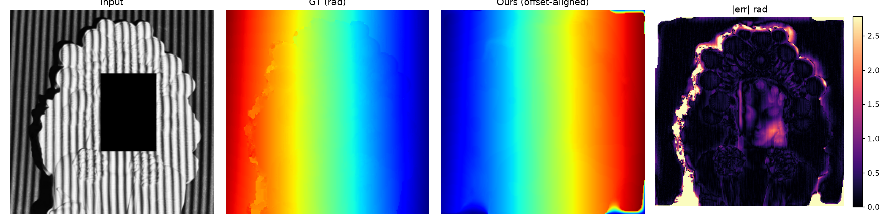
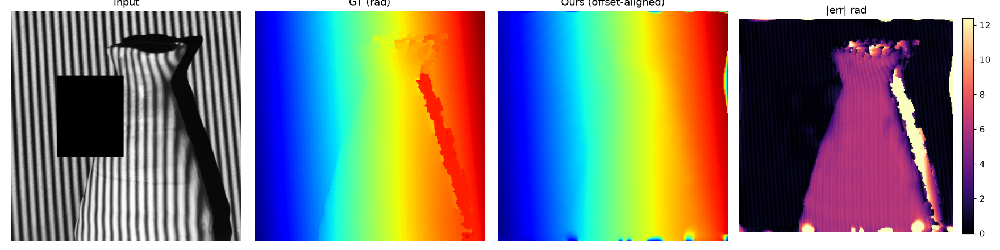
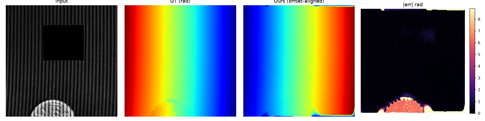
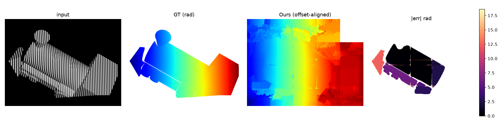
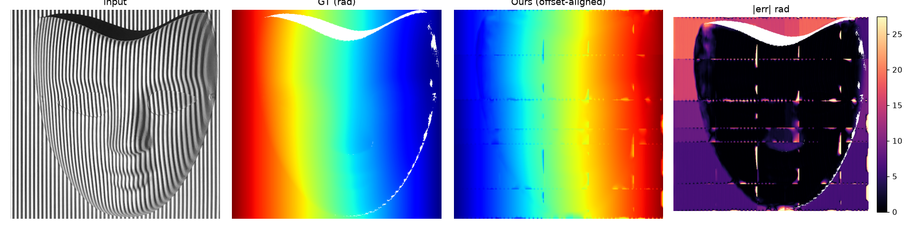
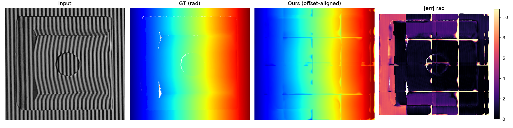

# 真实 6 场景定性 + 点误差表（描述性，不挂门禁）

**日期**：2026-11-21 ｜ **代码**：`code/w9_real_qual.py` ｜ **JSON**：`probes/results/w9_real_qual.json` ｜ **图**：`probes/results/w9_real_qual/*.png`

**范围**：GT audit 判定可作像素级参考的 6 个场景（scene_01/04/05、Train、实测2、实验4）。**不是 G7**：G7 已由真实 C1 的 n_P=0 判为 insufficient；本表只作 S8 的真实定性/点误差描述。

**方法**：
- 单帧 256² 原生窗口，stride 128；ROI 用单帧 `estimate_roi`；frontend 后跑 S5 模型（seed0–4，seed4 主表）。
- 重叠窗按 overlap 做 **2π/offset 对齐**后再平均；否则每个窗的 frontend 活塞不同，直接平均会把相位撕开。
- 对齐：先 sign + 2πk + 常数 piston（offset），报 **raw**；另报 **wrap**（把 2π 分支折回，只看局部形状）。
- 指标：median、P95 raw、P95 wrap、`frac≤φ_tol`（φ_tol=π/10=0.314 rad）raw/wrap；seed4 为主，5-seed 给 mean。

---

## 1. 点误差表（seed4 主，5-seed 稳定性）

| 场景 | GT 来源 | 窗数 | 评估像素 | median (rad) | P95 raw | P95 wrap | frac≤φ_tol | frac≤φ_tol (wrap) | 5-seed median | 5-seed frac≤φ_tol |
|---|---|---:|---:|---:|---:|---:|---:|---:|---:|---:|
| scene_01 | gt_phase.npy | 1 | 65,107 | **0.137** | 1.856 | 1.346 | **0.746** | 0.749 | 0.138 | 0.741 |
| scene_04 | gt_phase.npy | 1 | 65,536 | 0.758 | 8.261 | 2.189 | 0.243 | 0.396 | 0.736 | 0.254 |
| scene_05 | gt_phase.npy | 1 | 65,536 | **0.138** | 5.935 | 0.665 | **0.819** | 0.842 | 0.143 | 0.800 |
| Train | gt15_rad+plane | 11 | 72,118 | 0.187 | 12.401 | 2.900 | 0.532 | 0.725 | 0.200 | 0.529 |
| 实测2 | 4-step unwrap | 16 | 342,997 | 0.543 | 18.323 | 2.932 | 0.397 | 0.584 | 0.572 | 0.395 |
| 实验4 | 4-step unwrap | 12 | 259,616 | 0.843 | 7.212 | 2.575 | 0.233 | 0.297 | 0.697 | 0.301 |

**读法**：
- raw P95 被 **2π 分支/遮挡边界** 放大（几到十几 rad），不能单独当“形状误差”；`P95 wrap` 与 `frac≤φ_tol` 更能反映局部形状。
- 5-seed 离散度很小（同场景差异 <0.1 rad），说明不是某个 seed 的偶然。

---

## 2. 结果分层（诚实写）

| 层 | 场景 | 结论 |
|---|---|---|
| **较好** | scene_01、scene_05 | median ≈0.14 rad，**75–82% 像素在 φ_tol 内**；单帧模型在这两个场景上可用 |
| **中等** | Train、实测2 | median 0.19/0.54 rad，**53%/40%** 在 φ_tol 内；窗接缝/遮挡边界有局部失败 |
| **较差** | scene_04、实验4 | median 0.76/0.84 rad，**仅 24%/23%** 在 φ_tol 内；真实域偏移明显 |

**不能写成“真实场景定性正确”**：6 个 GT 可用场景里只有 2 个达到“>75% 像素在 φ_tol 内”，其余明显退化。这是单帧模型在真实手机/4 步数据上的域偏移，与 C1 的 refusal 结论一致：真实数据不是合成 P 类，模型也没有在真实域上训练。

---

## 3. 图

| 场景 | 图 |
|---|---|
| scene_01 |  |
| scene_04 |  |
| scene_05 |  |
| Train |  |
| 实测2 |  |
| 实验4 |  |

每张：input / GT / Ours（offset 对齐）/ |err|。Train 与多窗场景可见窗口接缝与局部失败；scene_04/实验4 的 Ours 与 GT 形状明显不一致。

---

## 4. 对 S7/S8 的意义

- 真实部分三段式的第二段（定性+点误差）**已完成**；结论是“**真实域偏移明显，只有 2/6 场景 >75% 像素在 φ_tol 内**”，与 C1 refusal 11/11 一致，不矛盾。
- 论文写法：**refusal correctness 11/11** + **真实点误差表（描述性）** + **Limitations**（真实无 P 类小遮挡、真实域偏移、GT 的 2π 分支）；不写成“真实场景都恢复正确”。
- 没有挂门禁，没有用这张表调任何阈值；G7 仍是 insufficient（n_P=0）。

**复现**：
```bash
# GPU server, from 2/P2
python code/w9_real_qual.py --real-root data/real11 --ckpt-root runs \
  --seeds 0,1,2,3,4 --out probes/results/w9_real_qual.json
```
